<!-- _class: lead -->

# 分布式数据库开发

## 绪论

Hong

---

<!-- _class: question -->

## 思想实验：一台机器放得下，还要分布式吗？

假设一个账户系统需要：

- 在多个城市就近访问
- 单机或单机房故障时继续服务
- 资金不重扣、不凭空消失
- 容量与吞吐可以逐步扩展

**问题不是“能不能装下”，而是哪些故障下仍要满足哪些承诺。**

---

## 从宣传语到可检验契约

| 宣传语 | 需要追问 |
|---|---|
| 强一致 | 单键还是事务？是否服从真实时间？ |
| 高可用 | 哪些故障下？允许拒绝或降级吗？ |
| 无限扩展 | 扩展的是容量、吞吐，还是热点键？ |
| 零数据丢失 | 哪个确认点之后？假设多少副本故障？ |

> 一项系统能力，必须同时写出**对象、故障模型与可观测结果**。

---

## 分布式改变了确定性

- 消息可能延迟、重复、乱序或长期不可达
- 节点可以暂停、崩溃、重启，并丢失易失状态
- 每台机器看到的事件顺序可能不同
- 客户端超时后，操作结果可能处于“不确定”状态

**因此：失败不是一个异常分支，而是协议状态的一部分。**

---

## 本课程因果链


<!--
[Sources]
- Lamport, Time, Clocks, and the Ordering of Events in a Distributed System — https://www.microsoft.com/en-us/research/publication/time-clocks-ordering-events-distributed-system/
- Ongaro and Ousterhout, In Search of an Understandable Consensus Algorithm — https://raft.github.io/raft.pdf
-->

---

## 四个词贯穿整门课

<div class="columns">
<div>

### 不变式

任何允许的执行都不能破坏的业务规则。

### 历史

客户端观察到的调用、返回、超时与事务边界。

</div>
<div>

### 故障模型

系统明确考虑哪些失败，不考虑哪些失败。

### 代价

为保证正确性付出的延迟、吞吐、空间和复杂度。

</div>
</div>

---

<!-- _class: section -->

# CAP 并非产品分类表

## 它描述的是分区期间的一条不可能性边界

---

## CAP 中的三个词有严格语境

- **Consistency**：读写对象满足原子一致性，也就是线性一致性
- **Availability**：发往非故障节点的每个请求最终得到非错误响应
- **Partition tolerance**：即使网络任意丢失跨分区消息，系统仍满足规范

在异步模型发生网络分区时，不能同时保证前两项。

<!--
[Sources]
- Gilbert and Lynch, Brewer’s Conjecture and the Feasibility of Consistent, Available, Partition-Tolerant Web Services — https://www.cs.princeton.edu/courses/archive/spr22/cos418/papers/cap.pdf
-->

---

## 分区发生时，协议必须选择如何失败



<!--
[Sources]
- Gilbert and Lynch, Brewer’s Conjecture and the Feasibility of Consistent, Available, Partition-Tolerant Web Services — https://www.cs.princeton.edu/courses/archive/spr22/cos418/papers/cap.pdf
-->

---

## “选择一致性”不等于系统完全不可用

- 只拒绝无法证明安全的写入
- 允许读取明确标注时间点的快照
- 让多数派继续服务、少数派等待
- 按业务对象采用不同策略

**CAP 限制的是特定模型下的请求保证，不是整个网站只有开或关。**

---

## PACELC：平时也有代价

- **P**artition：分区时在 Availability 与 Consistency 之间取舍
- **E**lse：无分区时仍在 Latency 与 Consistency 之间取舍

PACELC 是有用的设计视角，但不必把所有系统硬贴两个字母。

<!--
[Sources]
- Abadi, Consistency Tradeoffs in Modern Distributed Database System Design — https://www.cs.umd.edu/~abadi/papers/abadi-pacelc.pdf
-->

---

## “网络谬误”可以变成评审清单

网络并不天然地满足：

- 可靠、零延迟、无限带宽、安全
- 拓扑不变、只有一个管理员
- 传输免费、环境同构

评审设计时，试着假设：

> 如果它不成立，系统如何检测、恢复并向用户暴露？

---

<!-- _class: section -->

# 本课程：既非算法库，亦非名词表

## 我们用同一套方法阅读协议、产品和故障报告

---

## 每个主题都按五步推理

1. 写出业务不变式
2. 定义客户端能观察到的历史
3. 明确节点、网络与存储的故障模型
4. 跟踪正常路径与故障路径
5. 用实验寻找反例，而不是只看成功截图

---

## Python 用来构造模型，切勿当作生产系统

- 小规模模型让事件、消息和状态一目了然
- 固定随机种子，使课堂中的故障轨迹可以重放
- 多种种子用于探索更多调度，但仍不等于穷举证明
- 真正的结论必须回到协议规范、系统文档和观测历史

---

## 固定种子让随机故障可以复现

```python
from random import Random

rng = Random(2026)


def network_delay_ms() -> int:
    return rng.choice([5, 8, 13, 55])


def message_is_dropped() -> bool:
    return rng.random() < 0.10
```

种子是实验输入，应与日志、参数和代码版本一起记录。

---

## 第一个实验：确认是何意味？

三个副本维护同一个计数器：

1. 客户端向节点 A 发送 `increment(request_id)`
2. 网络可能丢失响应，客户端会重试
3. A 可能在复制前或复制后崩溃
4. 观察最终值、重复请求和已确认写入

**先定义正确结果，再写复制代码。**

---

## 莫把一次成功的运行当作正确性证据

至少得记录：

- 每次调用与返回的唯一请求编号
- 消息发送、接收和丢弃事件
- 节点重启前后的持久状态
- 最终检查的不变式
- 能重放失败的随机种子

---

## 课程组织

<div class="columns">
<div>

1. 绪论（本讲）
2. 时间观
3. 复制与共识
4. 分区与分片
5. 事务与并发
6. 分布式查询

</div>
<div>

7. 快照与恢复
8. 验证与可靠性
9. 架构对比
10. 课程大作业
11. 余论与综合诊断

</div>
</div>

---

## 学习方法：课前跑通，课堂推理，课后验证

- **课前**：阅读问题背景，运行给定脚本
- **课堂**：画事件顺序，主动寻找失败窗口
- **课后**：用“契约、证据、结论”的结构组织报告
- **复盘**：保存失败种子，而不是只保存最佳结果

---

## 成绩构成

| 环节 | 比例 | 关注点 |
|---|---:|---|
| 平时作业 | 20% | 概念与推理 |
| 课内实验 | 30% | 可复现的证据 |
| 期中考核 | 20% | 基础知识与应用 |
| 课程大作业 | 30% | 设计、实现、验证与反思 |

---

<!-- _class: takeaway -->

## 本讲小结

看到“强一致、高可用、可扩展”时，请追问：

**对什么对象，在什么故障下，客户端能观察到什么？**

下一讲：没有可信的天然全局时钟，系统如何建立顺序？
