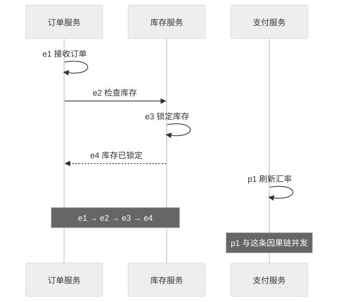

<!-- _class: lead -->

# 第1讲：分布式时间观

## 时钟报数，协议定序

Hong

---

<!-- _class: question -->

## 一毫秒的先后，能决定余额吗？

- 北京 ATM 显示 `15:00:00.000`：取款 ¥1000
- 上海手机显示 `15:00:00.001`：查询余额

仅凭两个终端时间戳，无法判断查询应看到哪个状态。

**必须说明事务在哪里排序、何时提交、查询读取哪个版本。**

---

## 单机也依赖顺序点，而不是客户端时钟

- 锁、日志序列号或提交序列决定数据库内部顺序
- 客户端时间可用于展示和审计，但不能替代并发控制
- “先到服务器”也不是业务真实时间，只是协议选择的顺序

分布式系统的困难，是顺序点被拆散到多个节点和多轮消息中。

---

## 物理时钟没有天然共享的“现在”

- 石英钟会漂移，温度与硬件差异会累积误差
- NTP 校时可能调整速率，错误配置也可能造成跳变
- 网络延迟不对称，使单次测量难以得到精确偏差
- 本地时间更适合记录“何时附近”，不适合独自证明因果

---

## 先定义因果，再谈时间戳

事件 $a \rightarrow b$ 当且仅当：

1. 它们在同一进程内，且 $a$ 先于 $b$
2. $a$ 是消息发送，$b$ 是对应消息接收
3. 存在 $c$，使 $a \rightarrow c$ 且 $c \rightarrow b$

这是一种**偏序**：有些事件彼此无法比较。

<!--
[Sources]
- Lamport, Time, Clocks, and the Ordering of Events in a Distributed System — https://www.microsoft.com/en-us/research/publication/time-clocks-ordering-events-distributed-system/
-->

---

## Happened-before 只排序能够传递影响的事件



<!--
[Sources]
- Lamport, Time, Clocks, and the Ordering of Events in a Distributed System — https://www.microsoft.com/en-us/research/publication/time-clocks-ordering-events-distributed-system/
-->

---

## Lamport 时钟保留因果方向

规则：

- 本地事件或发送前：`clock += 1`
- 消息携带发送方时钟
- 接收时：`clock = max(clock, message_clock) + 1`

若 $a \rightarrow b$，则 $C(a) < C(b)$；**反过来不成立**。

<!--
[Sources]
- Lamport, Time, Clocks, and the Ordering of Events in a Distributed System — https://www.microsoft.com/en-us/research/publication/time-clocks-ordering-events-distributed-system/
-->

---

## 最小实现把规则写进接口

```python
class LamportClock:
    def __init__(self) -> None:
        self.value = 0

    def tick(self) -> int:
        self.value += 1
        return self.value

    def receive(self, sent_at: int) -> int:
        self.value = max(self.value, sent_at) + 1
        return self.value
```

发送消息也应先调用 `tick()`，并把结果附在消息中。

---

## Lamport 时间戳不能识别并发

`C(a) < C(b)` 可能来自：

- 真实因果链：`a → … → b`
- 两个无关进程恰好得到不同计数

若要得到与因果关系等价的比较，需要记录更多维度。

---

## 向量时钟用空间换因果信息

每个进程维护向量 $V$：

- 本地事件：本进程分量加一
- 发送：携带完整向量
- 接收：逐分量取最大值，再将本进程分量加一

$V_a < V_b$ 当且仅当每个分量不大于且至少一个严格小于；互不支配表示并发。

---

## 向量时钟的代价随参与者增长

```python
def receive(local: list[int], remote: list[int], me: int):
    merged = [max(a, b) for a, b in zip(local, remote)]
    merged[me] += 1
    return merged
```

- 固定成员时实现直观
- 动态成员、海量客户端和元数据压缩更困难
- 工程系统常用版本向量、点式版本向量等变体

---

## HLC 把物理读数与逻辑顺序组合

Hybrid Logical Clock 常保存 `(physical, logical)`：

- 尽量跟随墙上时钟，便于版本回收和按时间查询
- 物理分量不前进时，用逻辑分量区分事件
- 接收消息时同时考虑本地物理时间与远端 HLC

它给出可排序时间戳，但**不会自动提供事务一致性**。

---

## TrueTime 不假装误差不存在

`TT.now()` 返回时间区间 `[earliest, latest]`，表达当前时刻的不确定性。

Spanner 使用该边界安排提交时间戳和等待，使默认可串行事务满足 external consistency。

关键思想：**不确定性无法消除，但变成协议输入。**

<!--
[Sources]
- Corbett et al., Spanner: Google’s Globally-Distributed Database — https://www.usenix.org/conference/osdi12/technical-sessions/presentation/corbett
- Google Cloud, Spanner: TrueTime and external consistency — https://docs.cloud.google.com/spanner/docs/true-time-external-consistency
-->

---

<!-- _class: section -->

# 顺序必须变成可恢复的记录

## 这就是日志进入数据库核心路径的原因

---

## 状态传输与操作日志

| 机制 | 适合做什么 | 主要条件 |
|---|---|---|
| 发送状态/快照 | 快速追上较大的差距 | 快照本身一致且可验证 |
| 发送操作日志 | 增量复制、审计、恢复 | 操作顺序明确，可确定性应用 |
| 两者结合 | 实际数据库常见方案 | 快照点与后续日志连续 |

---

## WAL 先保证恢复信息，再修改持久页面

典型约束：

1. 描述更新的日志必须先于对应数据页落盘
2. 向客户端报告提交前，提交日志必须达到规定的持久化点
3. 恢复时依据日志判断哪些更新需要重做或撤销

“写了日志”仍不等于“复制到了多数派”，两者是不同层的承诺。

---

## 同一条日志只有在操作确定时才能重放

危险状态机命令：

```python
def apply(command, state):
    state["token"] = random.random()   # 每个副本不同
    state["updated_at"] = time.time()  # 每个副本不同
```

应把随机结果、时间戳或外部读取结果在排序前确定，并作为命令数据复制。

---

## 可重放命令显式携带所有决定

```python
command = {
    "request_id": "req-1042",
    "account": "A",
    "delta": -100,
    "logical_time": 418,
}


def apply(command, state):
    if command["request_id"] not in state["seen"]:
        state["balance"] += command["delta"]
        state["seen"].add(command["request_id"])
```

---

## 请求编号解决“响应丢了以后怎么办”

客户端超时只说明**不知道结果**：

- 请求可能没有到达
- 请求可能执行但响应丢失
- 请求可能正在执行

重试必须复用同一个 `request_id`，由状态机持久记录去重结果。

---

## 课堂模拟器采用可重放事件队列

```python
SEED = 2026
rng = Random(SEED)

events = sorted(
    messages,
    key=lambda m: (m.deliver_at, m.sequence),
)
```

- 随机种子固定故障轨迹
- `sequence` 打破同一时刻事件的并列
- 日志记录种子、参数和每次状态转换

---

## 实验：区分四种“时间”

对一次写入分别记录：

1. 客户端墙上时间
2. 服务端墙上时间
3. Lamport/HLC 时间
4. 日志索引或事务提交时间戳

然后注入延迟与时钟偏差，判断每种时间能证明什么、不能证明什么。

---

## 思考题

1. 两个事件 Lamport 时间相同，能说明它们并发吗？
2. 两个向量时钟互不支配，意味着什么？
3. 固定随机种子保证了实验正确性吗？
4. 为什么日志重放要求状态机操作确定？

---

<!-- _class: takeaway -->

## 顺序不是时钟读数，而是协议产物

- 逻辑时钟描述因果或排序信息
- 日志把选定顺序变成可复制、可恢复的事实
- 时间服务可以帮助构造更强语义，但不能替代事务协议

下一讲：多个节点怎样同意同一份日志？
