<!-- _class: lead -->

# 第2讲：复制语义与共识

## 副本很多，意见可能不一致

Hong

---

<!-- _class: question -->

## 三个副本中，哪一个才是“真相”？

- A 已记录转账并向客户端确认
- B 尚未收到这条记录
- C 与 A 失去联系，但仍能接收请求

需要回答：

1. 谁能继续接受写入？
2. 已确认的写能否被覆盖？
3. 新负责人如何证明自己的日志足够新？

---

## 本讲故障模型

Raft 主要处理：

- 节点崩溃、重启和消息延迟/丢失
- 网络分区与重复消息
- 持久状态按规范保存

它不直接解决恶意节点、任意篡改或硬件静默数据损坏。那需要更强模型与额外机制。

<!--
[Sources]
- Ongaro and Ousterhout, In Search of an Understandable Consensus Algorithm — https://raft.github.io/raft.pdf
-->

---

## 复制对象决定协议语义

| 复制什么 | 优点 | 风险或条件 |
|---|---|---|
| 页面或文件状态 | 恢复直观 | 增量同步与一致快照复杂 |
| 数据库逻辑变更 | 与存储布局解耦 | 操作必须可确定性应用 |
| 有序状态机命令 | 容易推理共识 | 外部副作用需要另行处理 |

状态机复制的核心公式：相同初态 + 相同命令顺序 ⇒ 相同状态。

---

## 异步复制把低延迟换成丢失窗口

Leader 本地持久化后立即确认：

- 正常路径延迟低
- 慢副本不会阻塞写入
- Leader 在复制前永久故障时，已确认写可能丢失

这不是“最终一致”四个字能解释完的，必须写清故障切换规则。

---

## 多数派让任意两个成功集合相交

对 $N=2f+1$ 个投票成员：

- 多数派大小为 $f+1$
- 任意两个多数派至少共享一个成员
- 最多容忍 $f$ 个成员不可用，仍可组成多数派

相交只提供推理基础；协议仍需约束成员投票、日志新旧和任期。

---

## Paxos 给出“如何选定值”的基础

- Proposer 提出编号递增的提案
- Acceptor 遵守承诺，不接受更旧提案
- 值被多数 Acceptor 接受后成为 chosen
- Learner 获知已被选定的结果

本课程以 Raft 展开工程路径。Paxos 用来理解“多数相交 + 单调承诺”。

---

<!-- _class: section -->

# Raft 把共识拆成三件事

## 选举、日志复制、安全性

---

## Raft 的三种角色各自保持简单

- **Follower**：响应 RPC，接收合法 Leader 的日志与心跳
- **Candidate**：选举超时后增加任期，请求投票
- **Leader**：接收客户端命令，驱动复制和提交

任期 `term` 单调递增；看到更高任期时，节点更新任期并转为 Follower。

<!--
[Sources]
- Ongaro and Ousterhout, In Search of an Understandable Consensus Algorithm, Sections 5.1–5.2 — https://raft.github.io/raft.pdf
-->

---

## 随机选举超时用于打破对称

1. Follower 在超时前未收到合法 AppendEntries
2. 增加 `currentTerm`，转为 Candidate
3. 给自己投票，并向其他成员请求投票
4. 获得多数票后成为 Leader

固定超时会让多个节点反复同时参选；随机化降低碰撞概率。

---

## Candidate 不发送 Leader 心跳

Candidate 转回 Follower 的典型条件：

- 收到更高任期的任意合法 RPC
- 收到当前任期合法 Leader 的 AppendEntries
- 发起新一轮选举时仍是 Candidate，而不是“收到候选人心跳”

---

## 投票同时比较任期与日志新旧

一个节点在同一任期最多投一票，并要求候选日志不比自己旧：

1. 先比较最后一条日志的 `term`
2. 任期相同再比较最后索引

这条限制保证包含更多已提交信息的候选者不会输给明显落后的节点。

<!--
[Sources]
- Ongaro and Ousterhout, Raft paper, Election Restriction and RequestVote rules — https://raft.github.io/raft.pdf
-->

---

## 选举轨迹可以由种子稳定复现

```python
from random import Random

rng = Random(2026)
timeouts = {node: rng.randint(150, 300) for node in ("A", "B", "C", "D", "E")}
candidate = min(timeouts, key=timeouts.get)
```

课堂演示固定轨迹，测试时应遍历多个种子并保存失败种子。

---

## 日志复制先对齐前缀，再追加后缀

Leader 为每个 Follower 维护：

- `nextIndex`：下一次尝试发送的索引
- `matchIndex`：已知该 Follower 匹配到的最高索引

AppendEntries 携带 `prevLogIndex/prevLogTerm`；不匹配时回退，匹配后才追加。

---

## 当前任期条目达到多数，Leader 才直接推进提交



<!--
[Sources]
- Ongaro and Ousterhout, Raft paper, Figure 2 and Section 5.4.2 — https://raft.github.io/raft.pdf
-->

---

## 为何不能只数旧任期条目的副本数？

旧任期条目即使暂时出现在多数日志中，也可能处于尚未安全提交的结构。

Raft 的规则是：

- 用多数计数直接提交**当前任期**条目
- 当前任期条目提交后，其日志前缀一起成为已提交

避免把“复制得多”误作“已经提交”。

---

## 日志匹配性质把相同点之前锁成同一前缀

若两个日志在索引 $i$ 具有相同任期：

- 该索引保存同一条目
- 从起点到 $i$ 的所有条目都相同

Leader 通过前驱索引与任期逐步修复冲突后缀，而不是合并两边命令。

---

## 已提交不等于所有副本已经应用

- Leader 先确认条目已提交
- 每个节点按索引顺序推进 `lastApplied`
- 落后副本可以稍后追赶
- 读请求必须证明读取副本已经应用到所需位置

因此提交索引、应用索引和持久日志末尾是三个不同位置。

---

## 客户端重试需要会话级去重

```python
def apply(command, state):
    request_id = command["request_id"]
    if request_id in state.results:
        return state.results[request_id]

    result = execute(command, state)
    state.results[request_id] = result
    return result
```

去重结果必须成为复制状态的一部分，不能只放在 Leader 内存缓存。

---

## Leader 读也得证明自己仍有领导权

可线性化读的常见路径：

- **ReadIndex**：与多数派确认当前任期领导权，再等本地应用
- **租约读**：依赖明确的时钟和租约假设
- **日志屏障**：提交当前任期条目后读取，代价更高

“从 Leader 读”本身不足以证明读到最新提交。

---

## 成员变更不能一步替换整个集合

如果旧配置与新配置没有交叠，可能各自形成多数并选出不同 Leader。

Raft 论文使用联合共识，使过渡阶段同时受旧、新配置约束。后续工程实现也有单成员变更等方案。

<!--
[Sources]
- Ongaro and Ousterhout, Raft paper, Cluster Membership Changes — https://raft.github.io/raft.pdf
-->

---

## 快照压缩日志，但不能丢失协议位置

快照至少需要表达：

- 状态机在某个 `lastIncludedIndex/Term` 的状态
- 客户端去重表等业务状态
- 后续日志从哪个位置继续

快照安装是状态传输，它与后续日志复制共同完成追赶。

---

## 最小模拟器只实现可解释的子集

课堂版本聚焦：

- 随机选举超时
- RequestVote 的日志新旧比较
- AppendEntries 前缀检查
- 当前任期多数提交
- Leader 故障后的重选

“完整 Raft”还需考虑持久化、成员变更和并发网络等要素。

---

## 思考题

1. 五节点集群为何可以容忍两个节点不可用？
2. Candidate 收到同任期 AppendEntries 时应如何处理？
3. 已提交条目为什么可能尚未被某个 Follower 应用？
4. 客户端超时重试为何不能生成新的请求编号？

---

<!-- _class: takeaway -->

## 共识的结果是一条不会被未来推翻的已提交前缀

- 多数相交是基础，不是完整协议
- 任期与日志新旧约束选举
- 当前任期提交规则保护历史前缀
- 客户端、读路径与快照都属于正确性边界

下一讲：一条日志不够大时，如何把数据与共识组一起切开？
