<!-- _class: lead -->

# 第3讲：分区与分片

## 切开数据容易，保持路由、负载与事务边界一致很难

Hong

---

## 分区与分片，先分清语境

| 概念 | 本课使用方式 |
|---|---|
| 表分区 Partitioning | 一个逻辑表按规则分成可管理单元，未必跨节点 |
| 分片 Sharding | 数据分布到多个独立放置、路由或复制单元 |

具体产品术语可能不同。分析时关注**路由、放置和故障域**，不要只看名字。

---

## 切分数据服务的目标

- **管理**：归档、备份、索引维护与生命周期
- **性能**：分区剪枝、并行扫描与局部聚合
- **扩展**：把容量与请求分散到多个节点

同一种切分键不一定同时优化三个目标。

---

## Range 分区适合时间与有序范围

```sql
CREATE TABLE events (
  tenant_id BIGINT,
  happened_at TIMESTAMP,
  payload JSON
) PARTITION BY RANGE (happened_at);
```

- 范围查询和按周期归档自然
- 单调递增写入可能集中在最新分区
- 边界遗漏与时区处理需要测试

---

## Hash 分区追求均匀，不保留范围局部性

```sql
CREATE TABLE accounts (
  account_id BIGINT,
  balance DECIMAL(18, 2)
) PARTITION BY HASH (account_id)
PARTITIONS 16;
```

等概率键通常分布较匀；范围查询可能访问所有分区。

---

## 分区剪枝依赖谓词能否推导边界

容易剪枝：

```sql
WHERE happened_at >= :start
  AND happened_at <  :end
```

可能阻碍剪枝：对分区键使用不透明函数、隐式类型转换，或缺少常量边界。

优化前先看 `EXPLAIN`，不要仅凭 SQL 字面猜测。

---

## 本地索引与全局索引交换不同复杂度

- **本地索引**：索引与分区共置，维护和迁移简单
- **全局索引**：跨分区提供统一查找或唯一性，但写入、恢复和重分片更复杂

唯一约束若不包含分区键，往往会迫使系统引入全局协调或限制。

---

## 生命周期管理是分区最稳定的收益之一

按时间切分后可以：

- 以分区为单位加载或归档
- 对冷热数据使用不同存储策略
- 缩小备份、恢复和统计信息维护范围
- 避免逐行删除产生的大量日志与碎片

---

<!-- _class: section -->

# 分片把逻辑边界映射到物理副本组

## 此后每个请求都需要路由

---

## 一次请求要走完两层映射



<!--
[Sources]
- PingCAP, TiDB Architecture Overview — https://docs.pingcap.com/tidb/stable/tidb-architecture/
- Cockroach Labs, Architecture Overview — https://www.cockroachlabs.com/docs/stable/architecture/overview.html
-->

---

## Range 分片保留局部性，也容易形成尾部热点

- 相邻键放在相邻范围，扫描和前缀查询高效
- 范围可动态 split、merge 和迁移
- 时间戳或自增主键使最新范围承担大部分写入

解决热点不能只靠“分得更多”，还要改变键分布或写入路径。

---

## Hash 分片先打散键，再映射到桶

- 负载通常更均匀
- 单键路由简单
- 范围查询失去局部性
- 改变桶或节点数量可能触发迁移

工程上常用固定虚拟桶或一致性哈希，减少节点变化时的数据移动。

---

## 复合键把业务边界放在最前面

例如 `(tenant_id, order_id)`：

- 同租户操作容易共置
- 租户间可以迁移或限流
- 大租户可能独占热点
- 跨租户报表仍需分布式扫描

分片键设计决定事务查询的成本。

---

## 路由元数据必须允许版本变化

客户端缓存的范围映射可能过期：

1. 请求按旧映射发往节点 A
2. A 返回“范围已迁移/已分裂”及新线索
3. 客户端刷新元数据并重试

路由错误应是协议内可恢复状态，而非不可解释的服务器错误。

---

## 大集群往往运行许多小共识组

- 每个分片或范围由独立 Raft/Paxos 组复制
- 不同组可以并行提交
- 跨组事务需要额外协调
- 组数量过多会增加心跳、调度和内存开销

这就是“多 Raft”架构：扩展性来自拆分共识域。

---

## Leaseholder 或 Leader 决定请求落点

放置副本只解决数据存储位置，还要决定：

- 谁处理写入
- 谁可以提供强一致读取
- 租约转移时如何避免双重服务
- 读副本落后时对外承诺什么

副本位置、领导权和客户端地理位置共同决定延迟。

---

## 写路径同时经历路由、共识与索引维护

典型步骤：

1. 根据键定位分片
2. 找到该复制组的 Leader/Leaseholder
3. 追加并复制日志，达到提交条件
4. 应用数据与相关索引
5. 向客户端返回结果或可重试错误

跨分片二级索引会让一行写入触及多个组。

---

## 读路径必须明确新鲜度契约

- Leader/ReadIndex：追求最新已提交结果
- 租约读：在时钟与租约假设内减少往返
- Follower 强一致读：先确认并追上提交位置
- 有界陈旧读：显式选择过去时间点以降低延迟

“从副本读”不必然等于弱一致，关键在读协议。

---

## 热点形态

| 热点 | 典型原因 | 观察指标 |
|---|---|---|
| 写热点 | 单调键、明星商品、计数器 | 单组写入与锁等待 |
| 读热点 | 热门对象、缓存失效 | QPS、尾延迟、回源率 |
| 容量热点 | 大租户、倾斜键 | 分片字节数与增长率 |

不同热点需要不同修复，不能只做节点均衡。

---

## 再均衡并非免费的后台动作

- 复制快照或增量日志会占用网络与磁盘
- 迁移期间仍有前台请求
- 频繁移动会产生调度抖动
- 新副本追上前不能计入安全多数

调度器需要速率限制、滞后阈值与稳定窗口。

---

## 拆分热点键需要改变冲突域

可选策略：

- 给单调键增加散列前缀，再在读侧合并
- 将大租户拆成多个子桶
- 将只读热点复制到更多位置
- 把精确全局计数改成分段计数，再异步汇总

先确认业务不变式是否允许这些变化。

---

## 跨分片事务把成本乘到多个故障域

协调成本包括：

- 多组读写与锁/版本检查
- 原子提交协议
- 任一参与者的尾延迟
- 超时后的不确定结果与清理

目标是让高频事务尽量与分片键对齐。

---

## 分片键评审问题

1. 最常见事务访问哪些键？能否共置？
2. 写入是否单调或高度倾斜？
3. 二级索引与唯一约束会跨多少分片？
4. 迁移、拆分和故障切换时，路由如何更新？

---

## 固定种子重放同一批倾斜请求

```python
from random import Random

rng = Random(2026)
users = list(range(1, 1001))


def next_user() -> int:
    if rng.random() < 0.70:
        return rng.choice(users[:10])
    return rng.choice(users[10:])
```

实验同时比较 Hash、Range 与复合分片的最大分片负载。

---

## 课堂设计题：订单表如何分片？

需求：

- 用户常查自己的近三个月订单
- 商户处理待发货订单
- 平台做全局日报
- 大商户流量是普通商户数百倍

请给出键设计，并明确一种被优化的路径和一种被牺牲的路径。

---

<!-- _class: takeaway -->

## 分片设计是在选择局部性与冲突域

- 表分区偏向管理与剪枝，分片进一步引入物理路由
- Range 保留顺序，Hash 打散负载
- 每个分片通常对应独立复制组
- 热点、全局索引与跨分片事务决定真实成本

下一讲：多个分片参与一次业务操作时，如何保护不变式？
