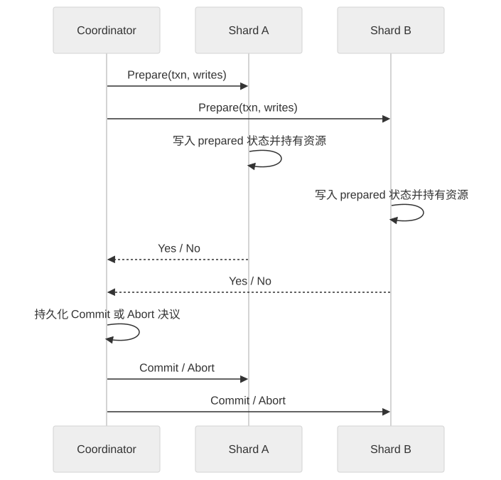

<!-- _class: lead -->

# 第4讲：事务与并发控制

## 事务的价值在于保护业务不变式

Hong

---

<!-- _class: question -->

## 以库存系统为例

库存系统可能需要：

- 每个 SKU 的可售数量不小于 0
- 订单成功与库存扣减原子对应
- 同一请求不能重复扣减
- 取消订单后释放量不能超过原扣减量

把规则写成不变式，才能判断隔离级别和协议是否足够。

---

## ACID 描述的是事务契约

- **Atomicity**：事务效果全部发生或全部不发生
- **Consistency**：每个已提交事务在假设成立时保持应用不变式
- **Isolation**：并发历史满足声明的隔离模型
- **Durability**：提交成功后，在声明故障模型内不会丢失

“C”不表示数据库自动理解所有业务规则；规则仍需约束、事务和代码表达。

---

## 隔离级别

- SQL 标准名称在不同实现中可能对应不同机制
- Repeatable Read 不一定等于 Snapshot Isolation
- Serializable 只约束等价串行顺序
- Strict Serializability 还要求串行顺序服从真实时间

讨论隔离时，优先列出允许和禁止的异常。

---

## MVCC 选择读版本

一个版本通常包含：

- 键和值
- 创建或提交时间戳
- 删除标记
- 可见性与事务状态信息

读事务按快照选择可见版本；写事务仍需解决写写冲突与提交原子性。

---

## 快照隔离很强，但不等于 Serializable

SI 常见规则：

- 事务从一致快照读取
- 并发事务不能同时提交对同一对象的冲突写
- 不同对象上的写可能同时提交

因此它避免许多读异常，却仍允许 **write skew**。

<!--
[Sources]
- Berenson et al., A Critique of ANSI SQL Isolation Levels — https://www.microsoft.com/en-us/research/publication/a-critique-of-ansi-sql-isolation-levels/
-->

---

## 写偏差破坏跨对象不变式

初始状态：Alice 与 Bob 都在值班，不变式是“至少一人值班”。

两个 SI 事务都执行：

```sql
SELECT count(*) FROM shifts WHERE on_call = TRUE;
-- 两个事务都读到 2

UPDATE shifts SET on_call = FALSE
WHERE doctor = :me;
```

它们写不同记录，可同时提交，最终人数变为 0。

---

## 修复：制造可检测冲突

可选方案：

- 使用 Serializable/SSI，让系统检测危险依赖并中止一方
- 锁住参与规则判断的记录或谓词范围
- 把跨行不变式物化为单行 guard，再锁定该行
- 重构数据模型，使冲突写落到同一个对象

---

## 悲观控制先等待，乐观控制后验证

| 机制 | 适合 | 主要代价 |
|---|---|---|
| 2PL / 锁 | 高冲突、等待可接受 | 阻塞、死锁、跨分片长尾 |
| OCC | 低冲突、事务较短 | 提交校验与重试 |
| SSI | 希望保留快照读 | 危险结构跟踪与回滚 |

MVCC 是版本管理基础，可以与这些机制组合。

---

## OCC 的正确性依赖完整的冲突集合

典型流程：

1. 读取某个版本并计算写集
2. 提交时验证读取集合未被冲突写修改
3. 验证成功后原子安装写集
4. 失败则放弃旧计算并重新执行事务

只比较被更新行的版本，可能漏掉谓词或跨对象依赖。

---

<!-- _class: section -->

# 跨分片原子提交

## 2PC：“同进退共命运”

---

## 无法单独退出的 prepared 状态



<!--
[Sources]
- Gray, The Transaction Concept: Virtues and Limitations — https://jimgray.azurewebsites.net/papers/theTransactionConcept.pdf
- PingCAP, TiDB Transaction Overview — https://docs.pingcap.com/tidb/stable/transaction-overview/
-->

---

## Prepare 成功意味着参与者承诺等待最终决议

参与者需要：

- 检查约束、冲突与本地可提交性
- 持久化 prepared 状态
- 保留提交所需锁或写意向
- 在恢复后继续询问 Commit/Abort 决议

因此 prepared 不是普通的暂存，而是协议义务。

---

## 协调者必须先持久化决议，再通知参与者

若所有参与者投 Yes：

1. 协调者持久化 Commit 决议
2. 再向各参与者发送 Commit
3. 重启或消息重试时重复发送同一决议

若决议尚不可知，prepared 参与者不能擅自提交或回滚。

---

## 复制协调者能降低故障影响，但不自动消除阻塞

- 共识日志可以让新的协调者恢复已记录决议
- 参与者仍需最终获知该决议
- 若协议没有规定可安全推导决议的路径，prepared 状态仍会等待

是否“非阻塞”是完整提交协议的性质，不能由“用了 Raft”直接推出。

---

## 客户端超时后，提交结果可能不确定

`COMMIT` 超时不等于回滚：

- 决议可能已经提交，只是响应丢失
- 协调者可能尚未作出决议
- 客户端重试可能重复业务副作用

应用需要事务状态查询、幂等请求编号或可恢复工作流。

---

## 减少跨分片事务的方式

1. **共置**：让高频事务的数据共享分片键
2. **物化冲突**：把关键不变式集中到可协调对象
3. **拆分契约**：把无需同步完成的副作用移出核心事务

减少不等于禁止；资金与库存等不变式不能为了性能随意拆散。

---

## Outbox 解决“数据库提交后消息没发出”

在同一个本地事务中：

```sql
BEGIN;
UPDATE orders SET status = 'PAID' WHERE id = :id;
INSERT INTO outbox(event_id, topic, payload)
VALUES (:event_id, 'order-paid', :payload);
COMMIT;
```

后台发布器可重复发送；消费者必须按 `event_id` 去重。

---

## Saga 是补偿工作流，不是自动原子事务

- 每一步提交自己的本地事务
- 后续失败时执行语义上的补偿动作
- 中间状态可能被外部观察
- 补偿可能失败，也未必能恢复现实世界

使用 Saga 前必须列出允许暴露的中间状态和人工处理边界。

---

<!-- _class: section -->

# 确定性事务换一个顺序解决冲突

## 先排序，再让所有参与者按同一剧本执行

---

## Calvin 把在线协调移到执行之前

- Sequencer 为事务输入确定全局顺序
- 输入先复制，再由各分片按该顺序调度
- 确定性锁顺序减少运行时分布式提交协调
- 传统 Calvin 更适合能预知读写集的事务

它减少特定路径的 2PC 成本，不代表事务没有复制或恢复协议。

<!--
[Sources]
- Thomson et al., Calvin: Fast Distributed Transactions for Partitioned Database Systems — https://www.cs.yale.edu/homes/thomson/publications/calvin-sigmod12.pdf
-->

---

## 固定种子用于重放同一并发调度

```python
from random import Random

rng = Random(2026)
schedule = ["alice_off", "bob_off"]
rng.shuffle(schedule)

for step in schedule:
    run_one_step(step)
```

示例应记录每一步读写，而不是只打印最终状态。

---

## 测试不变式要覆盖提交、回滚与不确定结果

银行转账检查：

- 总额守恒
- 每个请求最多生效一次
- 已确认成功的请求最终可见
- 失败请求没有部分效果
- 超时请求被标记为 unknown，而不是擅自归为失败

---

## 思考题

1. 为什么 SI 的“首次提交者赢”挡不住写偏差？
2. prepared 参与者为什么不能自行超时回滚？
3. Serializable 与 Strict Serializability 差在哪里？
4. Saga 的补偿为什么不等于数据库回滚？

---

<!-- _class: takeaway -->

## 选择事务机制前，先写出不变式和冲突

- MVCC 提供版本，隔离机制决定哪些历史被允许
- SI 可能写偏差，Serializable 可能要求重试
- 2PC 提供原子决议，但引入 prepared 等待与不确定结果
- 数据共置、幂等和 Outbox 能缩小协调范围

下一讲：事务正确以后，如何减少分布式查询的数据移动？
