<!-- _class: lead -->

# 第5讲：分布式查询

## CPU 很快，但搬错数据仍会让计划失败

Hong

---

<!-- _class: question -->

## 同一条 SQL，为什么分布式后突然变慢？

```sql
SELECT o.tenant_id, SUM(o.amount)
FROM orders o
JOIN users u USING (tenant_id, user_id)
WHERE o.created_at >= :start
  AND u.tier = 'gold'
GROUP BY o.tenant_id;
```

答案取决于数据放置、过滤选择率和 Join 前要移动多少字节。

---

## 最小系统模型

- 多个执行节点各保存一部分数据
- 协调者生成物理计划并汇总结果
- 节点之间可以交换分区数据流
- 统计信息可能陈旧或只在局部可见
- 网络、序列化与尾延迟进入代价模型

---

## 分布式算子多出 Exchange 这一层

常见交换：

- **Gather**：多个节点汇集到一个节点
- **Broadcast**：复制一份小输入到所有节点
- **Repartition/Shuffle**：按键重新分布
- **Merge**：合并有序流或局部 Top-K

Exchange 决定数据跨越哪些故障域和网络链路。

---

## Join 策略由共置与输入规模决定



---

## 本地 Join 最便宜，但要求数据已经共置

若两表都按 `(tenant_id, user_id)` 兼容分片：

- 每个节点只处理本地分区
- 不需要为 Join 重新搬运数据
- 最后仅汇总局部结果

这也是为什么分片键会影响未来的查询计划空间。

---

## Broadcast Join 复制小表，避免移动大表

成本近似：

$$C_{broadcast} \approx |small| \times (N-1)$$

适合维表或经过过滤后很小的输入。

风险：估计错误会把“大表”复制到所有节点，放大内存与网络压力。

---

## Shuffle Join 让相同键在同一目的分区相遇

两边都按连接键重新哈希：

$$C_{shuffle} \approx |left| + |right|$$

这是可扩展的通用方案，但会受到：

- 网络字节数
- 序列化与反序列化
- 热键倾斜和最慢分区

---

## 分布式代价不能只看总字节

可用的简化模型：

$$T \approx \max_i(\frac{bytes_i}{bandwidth_i} + cpu_i) + startup + coordination$$

平均值可能很好看，查询仍被最慢节点拖住。

---

## 越早下推谓词与投影，越少搬数据

```text
不好：Scan → Shuffle → Join → Filter → Project
更好：Scan → Filter → Project → Shuffle → Join
```

前提：下推不能改变语义；外连接、非确定函数和权限过滤都需要谨慎。

---

## 两阶段聚合把中间结果压缩在本地

例如 `GROUP BY tenant_id`：

1. 每个节点先计算局部 `SUM/COUNT/MIN/MAX`
2. 仅传输每组的部分状态
3. 汇总节点合并部分状态

可合并聚合很适合分层执行；中位数等算子需要更复杂状态或近似算法。

---

## 分布式 Top-K 先局部裁剪，再全局合并

每个节点返回本地前 $K$：

- 全局候选最多 $N \times K$
- 协调者再选全局前 $K$
- 有序索引和阈值算法可进一步减少读取

若排序键含并列值，需要定义稳定且可重复的 tie-breaker。

---

<!-- _class: section -->

# 优化器敢不敢做选择？统计信息说了算

## 错误估计会把对的算法放到错的输入上

---

## 基数估计从选择率开始

简单估计：

$$rows_{out}=rows_{in}\times selectivity$$

但真实数据可能存在以下情况：

- 列相关性
- 长尾分布与热点值
- 分区间分布差异
- 陈旧统计和新分区冷启动

---

## 全局平均值会掩盖分片倾斜

假设 100 个租户平均各有 1 万行，但最大租户有 3000 万行。

- 平均值预测每个分片工作相近
- 热租户所在分片决定尾延迟
- 广播或 Shuffle 的内存峰值可能集中在一个节点

应收集 Top-N、直方图和分区级统计。

---

## 优化器需要在计划空间与规划时间之间取舍

- Join 顺序数量随表数快速增长
- 分布式计划还要选择交换位置与并行度
- 启发式规则先缩小搜索空间
- 代价模型在候选计划中选择
- 运行时反馈可以触发自适应调整

---

## 可解释的策略选择器比“智能黑盒”更适合

```python
def choose_join(left_mb, right_mb, colocated, nodes):
    if colocated:
        return "local"
    small = min(left_mb, right_mb)
    broadcast = small * (nodes - 1)
    shuffle = left_mb + right_mb
    return "broadcast" if broadcast < shuffle else "shuffle"
```

之后再加入内存上限与倾斜惩罚。

---

## 固定种子生成可重复的数据倾斜

```python
from random import Random

rng = Random(2026)


def tenant_id() -> int:
    if rng.random() < 0.60:
        return 1
    return rng.randint(2, 100)
```

比较总耗时之外，还要记录最大分区行数与 P95 分区耗时。

---

## EXPLAIN 要验证的事

1. 分区剪枝是否发生
2. 过滤和投影在哪一层执行
3. Exchange 是 Broadcast 还是 Repartition
4. 估计行数与实际行数偏差多大

计划名称只是线索；运行时统计才是证据。

---

## 实验 A：Join 策略交叉点

控制变量：

- 节点数
- 小表大小
- 网络带宽
- 每节点内存上限

画出 Broadcast 与 Shuffle 的估计成本交叉点，再用模拟执行验证趋势。

---

## 实验 B：下推与局部聚合

对同一查询比较：

- 不下推
- 仅谓词下推
- 谓词 + 投影下推
- 再加入局部聚合

记录扫描行数、网络字节、中间结果峰值和总时间。

---

## 实验 C：热键如何拖慢整个查询

在相同总行数下改变 Zipf/热点比例：

- 观察各分区输入行数
- 记录最大分区与平均分区的比值
- 尝试盐值拆键、热点广播或两阶段聚合

优化目标是降低关键路径，而不只是降低平均值。

---

## 常见反模式

- 对小结果执行全量 Gather 后再过滤
- 未限制大小就选择 Broadcast
- 把全局平均统计当作每个分片统计
- 只看协调者 CPU，忽略网络与最慢分片
- 用增加并行度掩盖热点键

---

## 思考题

1. 两表都很大但已按连接键共置，应选哪种 Join？
2. Broadcast 的网络成本为什么随节点数增长？
3. 局部聚合何时无法显著减少数据？
4. 总字节相同，为什么倾斜仍会增加尾延迟？

---

<!-- _class: takeaway -->

## 分布式查询优化首先管理数据移动

- 共置决定本地 Join 的可能性
- Broadcast、Shuffle 各有明确成本边界
- 下推与局部聚合减少中间数据
- 分区级统计和热点决定关键路径

下一讲：数据写对以后，崩溃时怎样恢复到一致状态？
