<!-- _class: lead -->

# 第8讲：架构比较

## 架构的“保证”如何从机制中产生

Hong

---

## 同一个系统，要从五个镜头观察

---

## 正式开始比较之前，先固定问题

- 它向应用承诺什么一致性与隔离级别？
- 事务顺序在何处形成？
- 数据如何切分、复制与迁移？
- 正常路径和故障路径各经过哪些组件？
- 它怎样证明或检验自己的正确性？

只列“支持 SQL、水平扩展、高可用”，无法解释差异。

---

<!-- _class: section -->

# Spanner

## 借助带误差界的时间 API，把真实时间纳入提交协议

---

## Spanner 把外部一致性作为默认事务语义

- 读写事务提供 serializability
- 不重叠事务的顺序服从真实时间
- 官方将这项保证称为 **external consistency**

关键不只是有原子钟，而是算法显式使用 TrueTime 返回的不确定区间。

<!--
[Sources]
- Google Cloud, TrueTime and external consistency — https://docs.cloud.google.com/spanner/docs/true-time-external-consistency
- Corbett et al., Spanner: Google's Globally-Distributed Database — https://www.usenix.org/conference/osdi12/technical-sessions/presentation/corbett
-->

---

## Commit wait 用等待换取时间顺序

协调者选择提交时间戳后，等待到 TrueTime 能确认该时刻已经过去，再向客户端报告提交成功。

> 时间 API 给出的是区间；协议把区间转化为可证明的顺序边界。

代价是写路径要吸收时钟不确定度。

---

## Spanner 的问题意识

适合问：

- 跨地域事务必须给应用强实时语义吗？
- 读能否使用时间戳或有界陈旧性换取更低延迟？
- 时间基础设施和多副本协议的成本是否值得？

“全球分布”不免费，而是一组延迟、成本与语义选择。

---

<!-- _class: section -->

# CockroachDB

## 用 HLC、Range 与 Raft 构造可水平扩展的 SQL 系统

---

## CockroachDB 默认使用 Serializable 隔离

官方当前文档把 `SERIALIZABLE` 列为默认事务隔离级别，并另提供 `READ COMMITTED`。

这说明产品比较必须区分：

- 数据库声明的隔离级别
- 单键副本协议的线性化语义
- 是否额外承诺事务的真实时间顺序

别把三个概念压成一句“强一致”。

<!--
[Sources]
- Cockroach Labs, Transactions and Developer Basics — https://www.cockroachlabs.com/docs/stable/developer-basics.html
-->

---

## Range 把数据分布与共识组绑定

- 有序键空间被划成可分裂、可迁移的 Range
- 每个 Range 的副本组使用 Raft
- 多 Range 事务需要额外的事务协调
- HLC 为版本与事务提供可比较的时间戳

单个 Raft 组解决不了跨分片原子性，它只是组成事务协议的可靠部件。

<!--
[Sources]
- Cockroach Labs, Architecture Overview — https://www.cockroachlabs.com/docs/stable/architecture/overview.html
-->

---

<!-- _class: section -->

# Calvin

## 先确定事务顺序，再按顺序执行

---

## Calvin 把不确定性前移到排序阶段

典型流程：

1. Sequencer 为事务形成确定顺序
2. 顺序被复制，所有副本获得同样的输入
3. Scheduler 按确定计划获取所需锁并执行

因此事务通常需要预先知道读写集合，或先做 reconnaissance。

<!--
[Sources]
- Thomson et al., Calvin: Fast Distributed Transactions for Partitioned Database Systems — https://www.cs.yale.edu/homes/thomson/publications/calvin-sigmod12.pdf
-->

---

## 确定性并非没有共识

Calvin 仍要可靠复制事务输入或顺序，它改变的是事务执行阶段的协调方式。

- 优势：跨分区执行可避开传统分布式提交路径
- 代价：临时交互、不可预知读写集合更难处理
- 风险：排序层与热点资源仍可能成为瓶颈

---

<!-- _class: section -->

# FoundationDB

## 事务系统做窄内核，数据模型由上层构造

---

## FoundationDB 默认提供严格可串行化事务

- 事务采用乐观并发控制
- MVCC 支持快照读取
- 普通读建立冲突范围，提交时验证
- snapshot read 可减少冲突，但相应放松隔离保护

“快照读更快”必须与“调用者承担哪些异常”一起讨论。

<!--
[Sources]
- Apple, FoundationDB Developer Guide: Transactions and Consistency — https://apple.github.io/foundationdb/developer-guide.html
-->

---

## Layer 把通用事务内核变成不同数据模型

有序键值空间提供：

- 原子事务
- 范围读取
- 版本化与冲突检测

文档、图、队列或 SQL 能在 Layer 中构造。好处是内核集中，代价则是数据模型语义由上层负责。

---

## 确定性仿真把罕见故障变成可重复测试

FoundationDB 的仿真环境以确定方式控制进程、网络、磁盘和时间，失败运行可由种子重放。

这是一条可迁移的工程原则：

> 对难以重现的并发系统，先让随机性成为输入，再让反例成为测试。

<!--
[Sources]
- Apple, FoundationDB Testing and Simulation — https://apple.github.io/foundationdb/testing.html
-->

---

<!-- _class: section -->

# TiDB

## SQL、事务存储与全局控制面分层协作

---

## TiDB 的三类核心组件职责不同

- **TiDB Server**：SQL 解析、优化与分布式执行
- **TiKV**：按 Region 存储数据并通过 Raft 复制
- **PD**：管理元数据、时间戳与副本调度信息

Region 会随数据增长分裂、迁移；不能把它讲成永远固定大小的分片。

<!--
[Sources]
- PingCAP, TiDB Architecture Overview — https://docs.pingcap.com/tidb/stable/tidb-architecture/
-->

---

## TiDB 的名称需要翻译回理论语义

- 默认事务模式为悲观事务
- `REPEATABLE READ` 的官方语义是 Snapshot Isolation
- 另支持 `READ COMMITTED`
- 分布式事务模型受 Percolator 启发，使用 2PC

所以“支持 RR”不能直接推出可串行化。

<!--
[Sources]
- PingCAP, Transaction Overview — https://docs.pingcap.com/tidb/stable/transaction-overview/
- PingCAP, Transaction Isolation Levels — https://docs.pingcap.com/tidb/stable/transaction-isolation-levels/
-->

---

## Follower Read 不必等于弱一致读取

TiKV 可通过 Raft 的 ReadIndex 确认副本已应用足够新的日志，从 follower 提供强一致读取。

是否更快仍取决于：

- leader 与 follower 的位置
- 日志追赶程度
- ReadIndex 协调开销

“读副本”描述位置，不自动描述一致性等级。

<!--
[Sources]
- PingCAP, TiDB Follower Read — https://docs.pingcap.com/tidb/stable/follower-read/
-->

---

## 五个系统，五种主要组织思想

| 系统 | 组织事务与分布的主线 |
|---|---|
| Spanner | 时间不确定区间 + 同步复制 |
| CockroachDB | Range + Raft + HLC + 事务协调 |
| Calvin | 预排序 + 确定性调度 |
| FoundationDB | 严格事务内核 + Layer |
| TiDB | SQL / TiKV / PD 分层 |

表格每一行都隐藏着不同的工作负载假设。

---

## 用请求路径检验架构理解

任选一个系统，画出跨两个分片的读写事务：

1. 谁接收请求？
2. 谁分配顺序或时间戳？
3. 哪些副本必须响应？
4. 冲突何时发现？
5. 客户端收到成功前还要等待什么？

画不出故障路径，就还没有真正理解架构。

---

<!-- _class: question -->

## 课堂决策：订单系统该选什么？

约束：三地部署、99% 事务在单地域、必须避免超卖、允许报表延迟一分钟。

请先写下必须保证的不变式，再讨论：

- 哪些数据需要同步跨地域？
- 哪些读可以使用快照或陈旧副本？
- 故障切换时宁可拒绝什么操作？

---

## 选型报告至少要包含四种证据

- **语义证据**：官方保证与应用不变式相配
- **路径证据**：关键请求经过的组件与网络往返
- **实验数据**：固定环境下的延迟、吞吐与故障恢复
- **反例证据**：不能满足需求时的最小历史或场景

没有一种数据库能替代需求建模。

---

<!-- _class: takeaway -->

## 本讲小结

系统名称会变，比较方法更耐久：

**保证 → 顺序 → 分片与复制 → 请求路径 → 验证。**

架构不是组件“拼图”“接水管”，而是把假设转化为可观察行为的机制。
